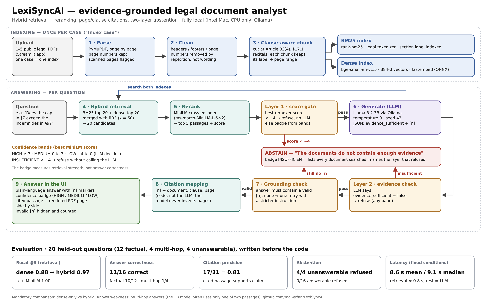

# LexiSyncAI

Evidence-grounded legal document analyst: upload 1–5 legal PDFs, ask questions,
and get plain-language answers with page and clause citations, or an explicit
"insufficient evidence" when the documents don't support an answer.

Final project for Deep Learning & GenAI (DA3), SRH Hochschule Hamburg.

## Status

- [x] Step 1: PDF parser (page text, page labels, scanned-page detection)
- [x] Step 2: Header/footer removal
- [x] Step 3: Clause-aware chunking
- [x] Step 4: Single `ingest_pdf` pipeline function + automated tests
- [x] Step 5: BM25 + dense indexes
  - [x] 5A: Legal-aware tokenizer
  - [x] 5B: BM25 index
  - [x] 5C: Dense index (bge-small)
  - [x] 5E: Retrieval tests
- [x] Step 6: Hybrid retrieval (RRF) + cross-encoder reranker, recall@k per configuration
- [x] Step 7: Grounded answers with page/clause citations, abstention, confidence badge (Llama 3.2 via Ollama)
- [x] Step 8: Streamlit UI (upload, detected structure, cited page side by side)
- [x] Step 9: Evaluation (20 held-out questions: correctness, citation precision, abstention, latency; dense-only vs hybrid comparison)
- [x] Step 10: Packaging and presentation
  - [x] 10.1: Makefile (one-command run), pinned dependencies, fixed seeds
  - [x] 10.2: One-page architecture diagram (`docs/architecture.png`)
  - [x] 10.3: Test on unseen PDFs; upload opened to 1–5 PDFs for the exam demo
  - [x] 10.4: Slides and a timed demo rehearsal

## Architecture



The same pipeline in short:

```
PDF -> parser -> cleaner -> chunker -> chunks
                                          |
              chunks -> BM25 (keywords) --+
                                          +--> RRF merge -> MiniLM reranker -> top 5 passages
              chunks -> Dense (meaning) --+
                                                                                     |
top 5 passages -> Llama 3.2 (Ollama) -> answer with [n] citations + confidence badge,
                                        or a refusal (two-layer abstention)
                                                                                     |
                               Streamlit UI: upload, structure, cited passage and PDF page side by side
```

### Ingestion (`ingestion/`)

| Module | What it does |
|---|---|
| `parser.py` | Reads every page into clean text lines. Keeps the page number and page label, and flags scanned (image-only) pages. |
| `cleaning.py` | Removes headers, footers and page numbers by detecting lines that repeat at the top or bottom of many pages. Works on any document without knowing its wording. |
| `chunker.py` | Cuts the document into clause-sized chunks. Each chunk carries a section label (`Article 83(4)`, `9.3`), a readable heading, and its start and end page. Merges heading-only pieces, ignores the table of contents, splits chunks over 1,500 characters, and never drops text. |
| `pipeline.py` | Single entry point. `ingest_pdf(path)` runs parse, clean and chunk and returns an `IngestedDocument` (chunks, page count, scanned pages, removed lines, detected sections). `ingest_many(paths)` handles a whole case. Raises clear errors for missing or unreadable files and duplicate file names. |

### Retrieval (`retrieval/`)

| Module | What it does |
|---|---|
| `tokenizer.py` | Turns text into search tokens while keeping legal references intact: amounts (`10 000 000` and `10,000,000` → `10000000`), references (`83(4)`, `6(1)(a)`), clause numbers (`9.3`) and redactions (`[***]` → `[redacted]`). |
| `bm25.py` | Keyword search with BM25 over each chunk's section label, heading and text. Strong on exact references and amounts. |
| `dense.py` | Semantic search with the pretrained `BAAI/bge-small-en-v1.5` embedding model (384-dimensional vectors, cosine similarity). Strong on paraphrased questions. |
| `hybrid.py` | Merges the BM25 and dense rankings with Reciprocal Rank Fusion (k = 60). Uses ranks, not scores, because the two score scales are not comparable. |
| `rerank.py` | Re-scores the top 20 hybrid candidates with the `Xenova/ms-marco-MiniLM-L-6-v2` cross-encoder and keeps the best 5. `RerankedIndex` is the full retrieval pipeline. |

All indexes return an empty result for a document without text (e.g. a fully
scanned PDF) instead of crashing.

**Embedding runtime:** `bge-small` and MiniLM run as ONNX models via
[fastembed](https://github.com/qdrant/fastembed) rather than PyTorch. PyTorch no
longer ships releases for Intel Macs (last version: 2.2.2), while ONNX Runtime
does, and it is fast on CPU. The models download from the Hugging Face Hub on
first use and are cached afterwards.

### Generation (`generation/`)

| Module | What it does |
|---|---|
| `prompt.py` | System prompt with the answering rules, and the user message: the top 5 passages numbered `[1]`–`[5]`, each with its label (document, section, page), then the question. |
| `llm.py` | Calls Llama 3.2 3B through Ollama with a JSON schema (`evidence_sufficient`, `answer`), temperature 0, seed 42, model kept loaded for 30 min. |
| `citations.py` | Finds `[n]` markers in the answer and splits them into valid (a retrieved passage) and invalid (invented) citations. |
| `thresholds.py` / `confidence.py` | Maps the best reranker score to a confidence band. Cut-offs are stored per reranker model, because each reranker scores on its own scale. |
| `answer.py` | `answer_question(question, index, documents_searched)` runs retrieval, the two abstention layers and the citation check, and returns an `Answer` (text, badge, citations with page and passage text, documents searched, latency, reason). |

**The LLM cites numbers, the code adds pages.** The model only writes `[n]`; the
code maps each number to its chunk, so document, clause and page come from the
parser, not from the model. A citation the model invents (e.g. `[6]`) is
detected as invalid.

**Two-layer abstention:**

| Best reranker score | Badge | What happens |
|---|---|---|
| ≥ 3 | HIGH | The LLM answers |
| 0 to 3 | MEDIUM | The LLM answers |
| −4 to 0 | LOW | The LLM decides whether the evidence is sufficient |
| < −4 | INSUFFICIENT | Refused without calling the LLM (Layer 1) |

In every band, the LLM can still refuse when it judges the passages insufficient
(Layer 2). An answer without a valid `[n]` citation gets one retry and is then
refused. Refusals name the documents searched.

### User interface (`app/`)

| Module | What it does |
|---|---|
| `main.py` | Page layout: upload 1–5 PDFs, index the case, show the detected structure, ask a question, show the answer. |
| `state.py` | Models loaded once (`st.cache_resource`), Ollama warm-up at start, uploads saved to `data/raw/uploads/case_<timestamp>/`, index building. |
| `views.py` | Structure cards (pages, sections, scanned pages flagged), answer with confidence badge, cited passages and rendered PDF pages side by side, refusal view with the documents searched and the abstention layer. |

The index is built once per case and kept in the browser session, so questions
don't rebuild it.

## Setup

Install [Ollama](https://ollama.com) and start it. Then, from the repository root:

```bash
conda create -n lexiSyncAI python=3.12 -y
conda activate lexiSyncAI
make setup      # pinned packages + Llama 3.2 model
make test       # 117 automated tests
make app        # start the UI
```

Run `make` alone to list all commands:

| Command | What it does |
|---|---|
| `make setup` | Install the pinned Python packages and download Llama 3.2 (Ollama) |
| `make test` | Run the automated tests |
| `make eval` | Run the retrieval and answer evaluation (several minutes) |
| `make score` | Rebuild the results table from the labelled final run |
| `make app` | Start the Streamlit UI |

The conda environment has to be created and activated first, because `make`
runs every command in a new shell and cannot activate it.

A Makefile is used instead of Docker: Ollama runs on the host, because running
the LLM inside Docker on macOS has no GPU/Metal access and is much slower.

All Python dependencies are pinned in `requirements.txt`; the LLM runs with
temperature 0 and seed 42, so answers are reproducible.

## Test corpus

The two test PDFs are included in `data/raw/` (both are public documents):

| File | Source |
|---|---|
| `gdpr_2016_679.pdf` | [EUR-Lex, Regulation (EU) 2016/679](https://eur-lex.europa.eu/eli/reg/2016/679/oj) |
| `vendor_contract.pdf` | SEC EDGAR, Sunrise Communications AG, F-4 (2024-08-26), Exhibit 10.4 |

## Usage

Run all commands from the repository root, with Ollama running.

**Start the app:**

```bash
python -m streamlit run app/main.py
```

Use `python -m streamlit`, not `streamlit run`: it puts the repository root on
the import path. Indexing GDPR + the Sunrise contract takes about 74 s on an
Intel Mac CPU; refreshing the browser page loses the index.

**Ingest** one or more PDFs and print a summary for each:

```bash
python -m ingestion.pipeline data/raw/gdpr_2016_679.pdf data/raw/vendor_contract.pdf
```

**Ask a question** from Python:

```python
from generation.answer import answer_question
from ingestion.pipeline import ingest_many
from retrieval.bm25 import BM25Index
from retrieval.dense import DenseIndex
from retrieval.hybrid import HybridIndex
from retrieval.rerank import RerankedIndex, Reranker

docs = ingest_many(["data/raw/gdpr_2016_679.pdf", "data/raw/vendor_contract.pdf"])
chunks = [c for d in docs for c in d.chunks]
index = RerankedIndex(HybridIndex(BM25Index(chunks), DenseIndex(chunks)), Reranker())

answer = answer_question(
    "Within how many hours must a controller notify a personal data breach?",
    index,
    [d.doc_name for d in docs],
)
print(answer.badge.value, answer.text)
for c in answer.citations:
    print(c.number, c.label)
```

**Evaluate:**

`make eval` runs both evaluations; `make score` rebuilds the results table from
the labelled final run. The individual steps:

```bash
python -m evaluation.evaluate_retrieval   # recall@k per configuration -> evaluation/results/retrieval.json
python -m evaluation.evaluate_answers     # answers, badges, abstention -> evaluation/results/answers.json
python -m evaluation.make_labels          # review.md + empty labels.json (never overwrites labels)
python -m evaluation.score_answers        # labels -> scores per question type -> evaluation/results/scores.json
```

Each ingestion stage also has its own command-line check:

```bash
python -m ingestion.parser data/raw/gdpr_2016_679.pdf 82                 # pages, scanned-page detection
python -m ingestion.cleaning data/raw/gdpr_2016_679.pdf 82               # lines removed, page before/after
python -m ingestion.chunker data/raw/gdpr_2016_679.pdf "Article 83(4)"   # chunks with a given label
python -m ingestion.chunker data/raw/vendor_contract.pdf "9.3"
```

## Tests

```bash
python -m pytest
```

117 tests, all passing.

| File | What it covers |
|---|---|
| `test_parser.py` | Page numbering, page-label fallback, reading order, scanned-page flagging |
| `test_cleaning.py` | Repeated headers/footers, numbered headers, page-number formats, short documents, no mutation of input |
| `test_chunker.py` | Section labels, heading merging, page ranges, table of contents, splitting long chunks, no text lost |
| `test_pipeline.py` | End-to-end on a generated PDF, error handling, determinism, multi-document ingestion |
| `test_corpus.py` | Real documents: GDPR page count, Art. 83(4)/83(5) pages, clause 9.3, `[***]` kept, chunk invariants |
| `test_tokenizer.py` | Amount normalisation, legal references, clause numbers, redactions, stopwords |
| `test_bm25.py` | Exact amounts, references from section labels, unrelated queries, empty index |
| `test_dense.py` | Fake model (no download): vector shape, query prefix, ranking, empty index |
| `test_hybrid.py` | RRF formula, chunks found by one or both lists, top-n limit, empty indexes |
| `test_rerank.py` | Best chunk first, sorted float scores, no model call without chunks, reordering of hybrid candidates |
| `test_citations.py` | Valid and invalid `[n]` markers |
| `test_confidence.py` | Score-to-band mapping |
| `test_answer.py` | Fake LLM and index: Layer 1 refusal without an LLM call, LLM refusal, cited answer, citation retry, invented citations, broken JSON |

The unit tests generate their own small PDFs and use fake models, so they run on
any machine without the corpus, a model download or Ollama.
`test_corpus.py` skips itself if the PDFs are not in `data/raw/`.

## Results

### Ingestion

| | GDPR | Sunrise contract |
|---|---|---|
| Pages | 88 | 45 |
| Scanned pages | 0 | 0 |
| Header/footer lines removed | 88 | 44 (page numbers) |
| Chunks | 635 | 191 |
| Labelled chunks | 634 | 185 |
| Distinct sections | 565 | 164 |
| Key checks | Art. 83(4) on p. 82, Art. 83(5) on p. 83 | Clause 9.3 on p. 22, `[***]` redactions kept |

The few unlabelled chunks are title and preamble text before the first recital
or clause. Distinct sections are fewer than chunks because long clauses are
split into pieces that keep the same label.

### Retrieval: recall@k per configuration

20 held-out questions (12 factual, 4 multi-hop, 4 unanswerable); page-level
recall on the 16 answerable ones.

| Setup | @1 | @3 | @5 | @10 | s/question |
|---|---|---|---|---|---|
| BM25 | 0.56 | 0.72 | 0.78 | 0.81 | 0.00 |
| Dense | 0.78 | 0.88 | 0.88 | 0.97 | 0.01 |
| Hybrid (RRF) | 0.50 | 0.94 | 0.97 | 1.00 | 0.01 |
| **Hybrid + MiniLM** (used) | 0.75 | 0.97 | 1.00 | 1.00 | 0.69 |
| Hybrid + bge-reranker | 0.81 | 1.00 | 1.00 | 1.00 | 4.80 |

**Mandatory comparison, dense-only vs hybrid:** recall@5 rises from 0.88
(dense) to 0.97 (hybrid) and 1.00 (hybrid + MiniLM). MiniLM was chosen over
bge-reranker: about the same recall, 7× faster, 87 MB instead of 1 GB.

BM25 and dense fail on different questions: BM25 finds exact references
(`Article 83(4)`, `20 000 000 EUR`) that dense misses, and dense finds
paraphrased questions with no shared keywords. Hybrid retrieval combines both.

### Answers and abstention

Same 20 questions through `answer_question()` (Llama 3.2 3B, temperature 0,
seed 42, top 5 passages):

| Run | What changed | Unanswerable refused | Answerable wrongly refused | s/answer |
|---|---|---|---|---|
| 1 | First version | 4/4 | 3/16 | ≈ 20 |
| 2 | Stronger prompt: rules 6–8, an example answer | 4/4 | 1/16 | ≈ 8 |
| 3 | One citation retry; passages in document order | 4/4 | 0/16 | ≈ 19 |

Layer 1 (score) refused 2 of the 4 unanswerable questions in about 1 s without
calling the LLM; Layer 2 (LLM check) caught the other 2. A first manual check
of run 3 found 11 of 16 answers correct, 3 correct with a flaw and 2 wrong or
poor; the final labelled evaluation is below.

### Final answer evaluation (Step 9)

One final run of the 20 questions in fixed conditions (charger in, Low Power
Mode off, other apps closed, one warm-up call before timing), saved as
`evaluation/results/answers_final.json`. Every answer and every cited passage
was then labelled by hand (`labels.json`) and scored with `score_answers.py`.

**Labelling rules:** *correct* = every fact in the expected answer present,
nothing false; *partly* = core right but a part missing or a minor detail
wrong; *wrong* = core claim false. A citation is *supported* if the cited
passage contains what the sentence carrying `[n]` claims.

| Type | n | Correct | Partly | Wrong | Citation precision | Unanswerable refused | Latency mean / median / max (s) |
|---|---|---|---|---|---|---|---|
| Factual | 12 | 10/12 (0.83) | 2 | 0 | 13/15 (0.87) | – | 10.2 / 10.3 / 18.8 |
| Multi-hop | 4 | 1/4 (0.25) | 2 | 1 | 4/6 (0.67) | – | 8.0 / 8.2 / 10.0 |
| Unanswerable | 4 | – | – | – | – | 4/4 (1.00) | 4.5 / 3.5 / 10.2 |
| **All** | 20 | **11/16 (0.69)** | 4 | 1 | **17/21 (0.81)** | **4/4 (1.00)** | 8.6 / 9.1 / 18.8 |

No answerable question was wrongly refused (0/16).

**Findings**
- Factual questions are reliable: 10/12 correct, none wrong.
- Multi-hop is the main weakness: retrieval finds the gold pages (recall@5 = 1.00),
  but the 3B model often uses only one of the two passages.
- Latency is mostly generation: retrieval + reranking ≈ 0.8 s, the rest grows
  with answer length. The same run under uncontrolled conditions averaged
  15.1 s instead of 8.6 s, with identical answers.

**Honest failures**
- **gdpr-08 (wrong):** says the maximum fine is 2% and lists the Art. 83(4)
  violations as the higher tier; Art. 83(5) is never used.
- **sun-07 (partly):** "neither party can terminate early" is false; only
  ordinary termination is excluded (§17.15 was never retrieved).
- **sun-03:** right answer, but the cited passage (§17.4) says nothing about
  confidentiality: correct, but not grounded.
- **gdpr-06:** the 4% figure is cited to Art. 83(4), the 2% tier.
- **sun-05:** copies "[***]% p.a." without saying the rate is redacted.
- **Badge vs correctness:** gdpr-05 is correct with LOW; gdpr-09 is incomplete with HIGH.

### Latency (Intel MacBook Pro, CPU only)

| Operation | Time |
|---|---|
| BM25 index, both documents (826 chunks) | < 1 s |
| Dense index, both documents (826 chunks) | ≈ 74 s |
| Retrieval + reranking per question | ≈ 0.7 s |
| Full answer per question | 8.6 s mean, 9.1 s median (fixed conditions); 15.1 s mean on battery / busy laptop |
| Refusal by Layer 1 | ≈ 1 s |

### Test on unseen documents

To prepare for the exam demo, the app was tested on two public EU regulations that were
not used during development or evaluation: Regulation (EU) 2026/2387 (AGILE defence
innovation programme, 25 pages) and Regulation (EU) 2026/1818 (welfare of dogs and
cats, 49 pages). Both were uploaded, indexed and questioned in the app, and the
pipeline worked end to end. This test was not labelled, so it is not part of the
numbers above. Both documents share the GDPR's EUR-Lex layout, so they test new
content rather than a new document format.

## Known issues

- The confidence badge measures retrieval, not correctness: a strongly matching
  passage gives HIGH even when the 3B model's answer is incomplete.
- Multi-hop answers are the weakest part: the model sometimes cites only one of
  the two clauses it needs.
- The dense index is rebuilt for every case (≈ 74 s) and is not saved. In the
  app it lives in the browser session, so refreshing the page loses it.
- The confidence bands were calibrated on the same 20 questions; they still
  need checking on unseen documents.
- Scanned pages are flagged but not OCR'd, and tables are not detected
  (optional bonus features).
- Header detection treats digits as interchangeable (`L 119/82` = `L 119/83`),
  so on short documents, body lines that differ only by a number could be
  mistaken for headers. Not observed on the test corpus.
- Grouped citation markers like `[3, 6]` are not detected by `generation/citations.py`
  (it only matches `[n]`), so an invented citation inside such a group is not flagged.
- The evaluation is small (4 multi-hop, 4 unanswerable questions) and was labelled by
  one person on one run, so the ratios are indicative only.

## Project layout

```
Makefile      One-command setup, tests, evaluation and app
docs/         Architecture diagram
ingestion/    PDF parsing, header/footer cleaning, clause-aware chunking, pipeline
retrieval/    Tokenizer, BM25, dense index, hybrid (RRF), cross-encoder reranker
generation/   Prompt, LLM call, citations, confidence bands, answer_question()
app/          Streamlit UI (main.py, state.py, views.py)
evaluation/   Question set, retrieval and answer evaluation scripts, results
tests/        Automated tests (pytest, 117 tests)
data/raw/     Test PDFs (committed); app uploads in data/raw/uploads/ (not committed)
```
